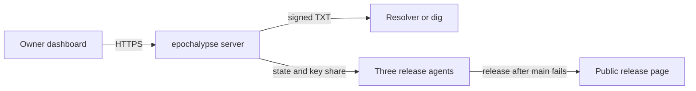

<p align="center">
  
</p>

<p align="center"><b>Time capsules, dead man's switches, and countdowns</b> through DNSSEC and independent release agents.</p>

<p align="center">
  <a href="https://github.com/Crank-Git/epochalypse/actions/workflows/check.yml"></a>
  
  <a href="LICENSE"></a>
</p>

<p align="center">
  <a href="docs/local-milestone.md"><b>Docs</b></a> ·
  <a href="#install"><b>Install</b></a> ·
  <a href="#quick-start"><b>Quick start</b></a>
</p>



## Why epochalypse

I wanted to see how much "release this later" an authoritative DNS server can carry. A
DNSSEC signature already has an inception and an expiration, a TTL already counts down,
and a TXT record is readable from anywhere a resolver is.

So epochalypse does four things from one Go binary. Signed TXT windows put content under
an explicit future signature window. Countdowns publish `v=epochalypse1 event=<UTC time>`
with a TTL equal to the seconds left. Capsules release content at a fixed time in public,
server-held, or tlock mode. Switches release content when the owner stops checking in.

The hard part was the switch. A dead man's switch that stops working when its server
goes down defeats the point, so each switch's state and key share live on three
independent agents that can release after the main server is gone. That runtime is
implemented and passes its isolated outage drill, but production switch use stays
disabled until it's verified on real hosts.

## Requirements

- **Docker with Compose**, **GNU Make**, **Python 3**, and **curl** for the local lab.
- **Go 1.27.3** and **golangci-lint 2.15.0** for native builds and `make check`.
- **dig**, if you want to query the authority directly.

## Install

There are no release binaries yet. Build from source:

```sh
git clone https://github.com/Crank-Git/epochalypse.git
cd epochalypse
go build -o bin/epochalypse ./cmd/epochalypse
```

`make build` cross-compiles `bin/epochalypse-linux-amd64` and `bin/epochalypse-linux-arm64`
with the commit stamped in. `go install` won't work, because `go.mod` replaces the DNS
library with the patched copy in `third_party/miekg-dns`.

## Quick start

The lab runs the main service and three agents in Compose, with synthetic DNSSEC keys and
a self-signed certificate. Start the Docker daemon, then run this from the repository root:

```sh
make lab
mkdir -p var/lab-client
docker compose -f deploy/lab/compose.yaml cp web:/state/lab/tls.crt var/lab-client/tls.crt
curl --fail --cacert var/lab-client/tls.crt https://localhost:8080/healthz
```

Health answers `ok`. Open `https://localhost:8080/owner` and sign in with the lab password,
`synthetic-lab-password`. Your browser will flag the certificate as self-signed, which is
expected; trust it only for this lab. DNS listens on `127.0.0.1:1053` over UDP and TCP.

The default lab turns on windows and capsules. Countdowns need a second synthetic key and
zone, which the [local walkthrough](docs/local-milestone.md) sets up before it exercises all
three features.

Stop the lab and keep its state:

```sh
docker compose -f deploy/lab/compose.yaml down
```

## Usage

### A countdown without Docker

This is how the banner was made. You need an algorithm 13 BIND key pair for the
countdown zone (`countdown.private` plus its sibling `countdown.key`, mode 0600, see
[window configuration](docs/windows.md#configuration)). Create the countdown offline, then
serve it on loopback. `--local-lab` lets the server run on a loopback address without TLS
or a public origin:

```sh
bin/epochalypse countdown create --state-dir var/state \
  --zone events.lab.invalid. --key-file keys/countdown.private \
  --title 'Synthetic event' --event-at 2026-12-01T12:00:00Z

bin/epochalypse server --local-lab --config config/local.example.json \
  --state-dir var/state --http-addr 127.0.0.1:8841 --dns-addr 127.0.0.1:8840 \
  --countdown-zone events.lab.invalid. --countdown-key-file keys/countdown.private
```

`countdown create` prints the record as JSON, including its DNS `name`
(`c<id>.events.lab.invalid.`). Query that name:

```console
$ dig @127.0.0.1 -p 8840 +noall +answer TXT ce1cc62af11f4982b30b8f1567f098e4d.events.lab.invalid.
ce1cc62af11f4982b30b8f1567f098e4d.events.lab.invalid. 881938 IN	TXT "v=epochalypse1 event=2026-12-01T12:00:00Z"
```

The TTL is the seconds until the event, computed fresh for each query. After the event, the
record stays with TTL zero until you delete it. Recursive TTLs are advisory, so don't treat
them as a release guarantee.

### Other commands

`epochalypse --help` lists every command. The ones you'll reach for first:

- `window` and `countdown` create and inspect records offline, with the server stopped.
- `capsule` creates or publishes local capsule content.
- `owner init` and `owner recover` manage the single owner from a protected password file.
- `token` creates a scoped API token.
- `switch` prepares, arms, checks in, exports, and recovers a switch against its three agents.
- `backup` encrypts or restores stopped main-service state.

## Documentation

| Page | What's there |
|---|---|
| [Signed TXT windows](docs/windows.md) | Keys, the creation API, and what a future signature does and doesn't hide. |
| [DNS countdowns](docs/countdowns.md) | Record format, TTL math, the API, and resolver results. |
| [Time capsules](docs/capsules.md) | Public, server-held, and tlock modes, export, and local recovery. |
| [Switches](docs/switches.md) and [switch runtime](docs/switch-runtime.md) | Drafts, arming, check-ins, agents, and the wire protocol. |
| [Owner access](docs/owner.md) | Owner commands, sign-in, sessions, and tokens. |
| [Local lab](docs/lab.md) and [walkthrough](docs/local-milestone.md) | Ports, files, reset, and every feature end to end. |
| [Deployment](docs/operations.md) | Containers, a Linux VPS example, DNSSEC delegation, and backups. |
| [Required checks](docs/checks.md) | What `make check` runs and the artifacts it keeps. |
| [Specification](docs/specs/spec.md) and [decisions](docs/adr/) | The approved spec and its ADRs. |

## Development

```sh
make check
```

This runs unit, integration, E2E, resolver, race, coverage, fuzz, lint, and build checks.
It needs Go 1.27.3 and golangci-lint 2.15.0 exactly; the browser and resolver suites run in
Docker. `make run` starts the main service alone with `config/local.example.json`, which
configures no signed DNS and no owner.

## Security

- Window content is public. A future DNSSEC signature doesn't keep TXT content secret.
- In server-held mode, the server operator holds the capsule key, and the server has to be
  up at release time.
- Production switch use is disabled until actual-host verification passes.

Use synthetic content locally. Keep real credentials, private keys, and production
infrastructure values out of tracked files.

## License

MIT. See [LICENSE](LICENSE).

---

<sub>Part of <a href="https://github.com/Crank-Git#things-over-port-53"><b>Things over port 53</b></a>,
my experiments in what else DNS can carry.
Siblings: <a href="https://github.com/Crank-Git/mcport53">mcport53</a> ·
<a href="https://github.com/Crank-Git/wingman">wingman</a> ·
<a href="https://github.com/Crank-Git/cachemoney">cachemoney</a> ·
<a href="https://github.com/Crank-Git/llamaoverdns">llamaoverdns</a> ·
<a href="https://github.com/Crank-Git/dnscalc">dnscalc</a> ·
Built by <a href="https://github.com/Crank-Git">Crank</a></sub>
