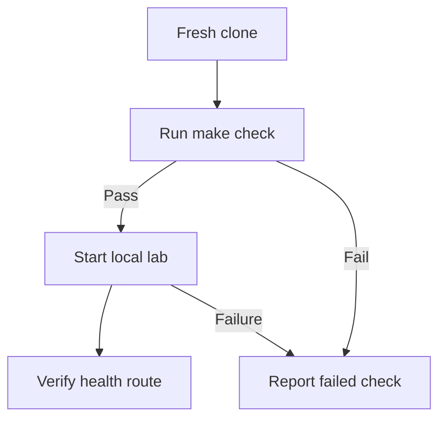

# Foundation

## Purpose

Establish the Go repository, repeatable checks, and a local deployment before feature work.

## User stories

As an owner, I want this feature so that I can verify the release behavior before I trust the deployment.

## Functional requirements

- FR-foundation-1: The repository defines Go 1.27.3 in its toolchain configuration.
- FR-foundation-2: The command `make check` exits successfully only when every required check passes.
- FR-foundation-3: The coverage check rejects first-party Go statement coverage below 95.00 percent.
- FR-foundation-4: The repository provides a `dev` branch for integration.
- FR-foundation-5: The CI workflow checks pull requests into `dev` and `main`.
- FR-foundation-6: The local lab starts the web server, DNS server, and three agents.
- FR-foundation-7: The smoke test receives HTTP 200 from `/healthz`.
- FR-foundation-8: The deployment status command reports the deployed commit identifier.
- FR-foundation-9: The demo command creates only synthetic content.

## User flows

1. Install the pinned tools.
2. Run `make check`.
3. Start the local lab.
4. Verify `/healthz`.
5. If a step fails, inspect its named error.

## Screens & states

This feature has no dedicated screen. The CLI reports progress, success, and structured errors.

## Behaviour rules

Use `cmd/epochalypse`, `internal/`, `web/`, `tests/`, `deploy/`, and `scripts/`.
Use Go standard libraries for HTTP, templates, JSON, and the CLI flag parser.
Create unit, integration, browser, and resolver test commands before product features.
Enable complexity, nesting, unused-code, and security checks in the selected pinned lint tool.
Pin tools and container images by immutable version or digest before their first use.
An empty test suite cannot satisfy the coverage gate.
Create `dev` after Git initialization. Keep production promotion separate from integration.
Protect both branches through the personal GitHub repository when it exists.
Use one integration PR for each epic. Internal draft PRs do not repeat the full CI suite.
Use local checks for each member change. Require full CI on the integration PR.

## Data touched

Create versioned state directories for the server and each agent. Seed no real secrets.

## Interfaces

Planned commands: `make build`, `make run`, `make lab`, `make demo`, `make check`, and `make clean-demo`.
`make clean-demo` requires an explicit synthetic namespace.
`scripts/deploy-status.sh <sha>` prints `<state> <jobId> <sha>`.
States are `pending`, `success`, `failure`, and `unknown`.
A successful status requires health checks against the requested deployed commit.
Go documentation: [release policy](https://go.dev/doc/devel/release), Go 1.27.3, retrieved 2026-11-04.

The API uses the shared error format in the project spec. Mutations require owner authorization unless this file states otherwise.

## Edge cases & failures

Missing Docker, tools, ports, or configuration produce actionable errors. A missing required CI tool fails CI.

## Acceptance criteria

Each criterion requires a test or a reproducible review record. The quoted behavior is the observable result.

- AC-foundation-1 covers FR-foundation-1: The repository defines Go 1.27.3 in its toolchain configuration.
- AC-foundation-2 covers FR-foundation-2: The command `make check` exits successfully only when every required check passes.
- AC-foundation-3 covers FR-foundation-3: The coverage check rejects first-party Go statement coverage below 95.00 percent.
- AC-foundation-4 covers FR-foundation-4: The repository provides a `dev` branch for integration.
- AC-foundation-5 covers FR-foundation-5: The CI workflow checks pull requests into `dev` and `main`.
- AC-foundation-6 covers FR-foundation-6: The local lab starts the web server, DNS server, and three agents.
- AC-foundation-7 covers FR-foundation-7: The smoke test receives HTTP 200 from `/healthz`.
- AC-foundation-8 covers FR-foundation-8: The deployment status command reports the deployed commit identifier.
- AC-foundation-9 covers FR-foundation-9: The demo command creates only synthetic content.

## Out of scope

Product behavior, real infrastructure purchase, automated production promotion, and real secrets.

## Open questions

The technical gates in the project spec apply. This feature has no additional product questions.
