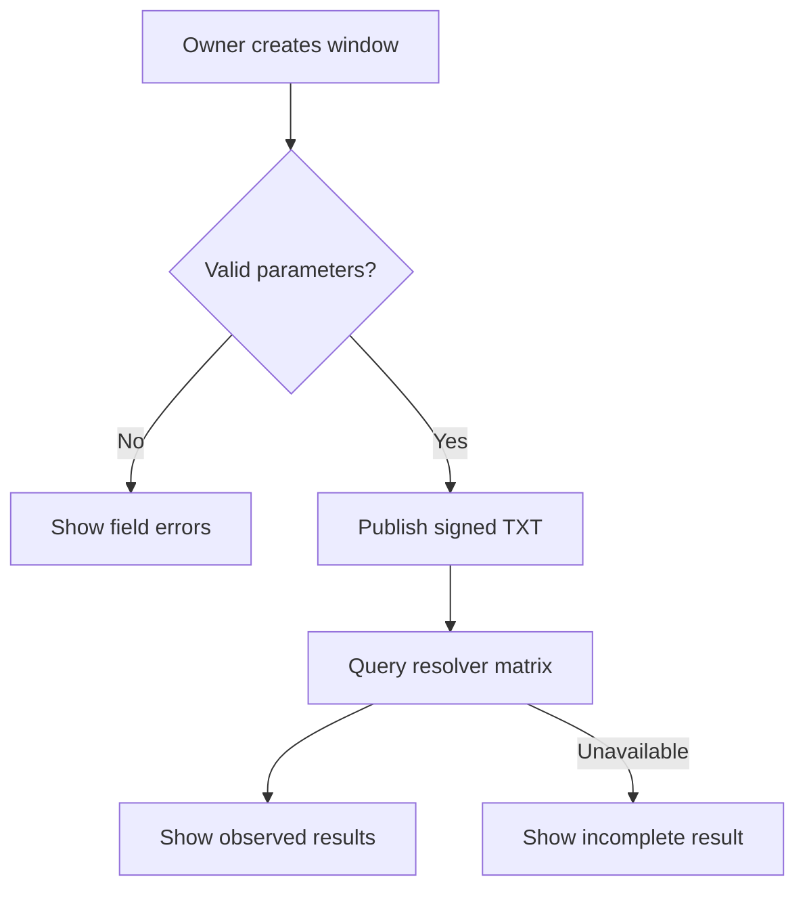

# DNSSEC signature windows

## Purpose

Let researchers inspect future signatures and compare resolver behavior without a confidentiality promise.

## User stories

As an owner, I want this feature so that I can verify the release behavior before I trust the deployment.

## Functional requirements

- FR-dns-window-1: The owner creates a TXT record with explicit signature inception and expiration times.
- FR-dns-window-2: The authoritative server serves the signed record before inception.
- FR-dns-window-3: The lab compares default Unbound, strict Unbound, and BIND behavior.
- FR-dns-window-4: The result records the resolver version and clock offset.
- FR-dns-window-5: The result records the response code and available validation flags.
- FR-dns-window-6: The public page labels this mode as public data.
- FR-dns-window-7: The lab demonstrates direct authoritative access before inception.
- FR-dns-window-8: The lab tests failure-cache behavior across inception.
- FR-dns-window-9: The deployment check verifies a trust anchor or a complete delegation chain.

## User flows

1. Enter public content and the signature window.
2. Submit the record.
3. If validation fails, correct the named fields.
4. Run the resolver comparison.
5. Inspect each result and its environment.

## Screens & states

[Open the mockup](../mockups/dns-window.html).

Empty: explain the experiment. Pending: show the run. Results: show each resolver. Error: show missing chain or unreachable resolver. Unauthorized: show sign-in.

## Behaviour rules

Use a dedicated experimental subdomain. Keep its future signatures separate from administration and release discovery.
Keep DNSKEY and delegation records valid during the experiment.
Limit public TXT content to 512 UTF-8 bytes. Split TXT strings at the DNS wire limit.
Use explicit UTC times. Require expiration after inception.
Do not add a currently valid alternate signature to the experimental RRset.
Test UDP truncation and TCP fallback. Disable recursive service on the authoritative listener.
Never infer confidentiality from SERVFAIL or the AD flag.
Show resolver results as observations. Do not promise acceptance exactly at inception.

## Data touched

Window: identifier, public content, zone, inception, expiration, DNSKEY reference, state. Observation: resolver, version, flags, clock, time, response.

## Interfaces

`POST /api/v1/windows` accepts `{content,inception,expiration}` and returns 201 with the window.
`POST /api/v1/windows/{id}/observations` starts a lab run and returns 202.
`GET /api/v1/windows/{id}/observations` returns the observations.
CLI: `epochalypse window create`, `epochalypse window inspect`, and `epochalypse lab verify`.
DNS: TXT, RRSIG, DNSKEY, DS, SOA, NS, and authenticated denial responses.
Protocol sources: [RFC 4034](https://www.rfc-editor.org/rfc/rfc4034.html), sections 3.1.4 and 3.1.5;
[RFC 4035](https://www.rfc-editor.org/rfc/rfc4035.html), sections 4.7 and 5.3.1;
[RFC 8914](https://www.rfc-editor.org/rfc/rfc8914.html), code 8.
Candidate adapter: [miekg/dns v1.1.73](https://github.com/miekg/dns/tree/v1.1.73).
Its upstream README recommends a successor. The compatibility spike decides the supported adapter before implementation.
Resolver source: [Unbound 1.26.2 manual](https://unbound.docs.nlnetlabs.nl/en/latest/manpages/unbound.conf.html).
The foundation pins actual resolver images after it verifies their version-specific manuals.

The API uses the shared error format in the project spec. Mutations require owner authorization unless this file states otherwise.

## Edge cases & failures

A missing chain produces an insecure or indeterminate result rather than proof of a signature window.
A resolver can permit clock skew, disable validation, or cache failures.
Test unsigned delegation, CD queries, expired signatures, rollover, and 32-bit timestamp boundaries.
The lab rejects ambiguous windows that cross unsupported serial-time ranges.

## Acceptance criteria

Each criterion requires a test or a reproducible review record. The quoted behavior is the observable result.

- AC-dns-window-1 covers FR-dns-window-1: The owner creates a TXT record with explicit signature inception and expiration times.
- AC-dns-window-2 covers FR-dns-window-2: The authoritative server serves the signed record before inception.
- AC-dns-window-3 covers FR-dns-window-3: The lab compares default Unbound, strict Unbound, and BIND behavior.
- AC-dns-window-4 covers FR-dns-window-4: The result records the resolver version and clock offset.
- AC-dns-window-5 covers FR-dns-window-5: The result records the response code and available validation flags.
- AC-dns-window-6 covers FR-dns-window-6: The public page labels this mode as public data.
- AC-dns-window-7 covers FR-dns-window-7: The lab demonstrates direct authoritative access before inception.
- AC-dns-window-8 covers FR-dns-window-8: The lab tests failure-cache behavior across inception.
- AC-dns-window-9 covers FR-dns-window-9: The deployment check verifies a trust anchor or a complete delegation chain.

## Out of scope

A general DNS provider, a recursive resolver, and secret content in this mode.

## Open questions

The technical gates in the project spec apply. This feature has no additional product questions.
