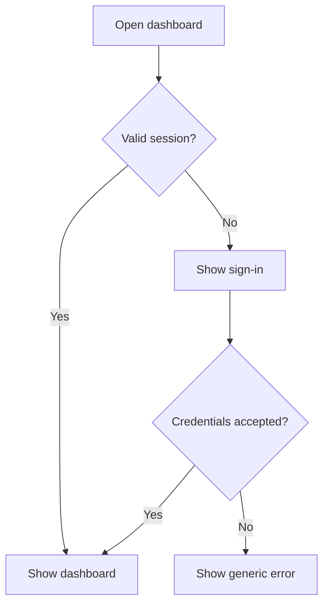

# Owner access

## Purpose

Protect administration with local credentials and scoped tokens. Provide public read access only to published content.

## User stories

As an owner, I want this feature so that I can verify the release behavior before I trust the deployment.

## Functional requirements

- FR-owner-1: The first setup command creates one owner identity.
- FR-owner-2: The web interface authenticates the owner with a local password.
- FR-owner-3: The API authenticates CLI requests with scoped tokens.
- FR-owner-4: The owner revokes a token without a server restart.
- FR-owner-5: The server rejects a web mutation without a valid CSRF token.
- FR-owner-6: The server limits failed sign-in attempts.
- FR-owner-7: The audit log excludes plaintext secrets and credential values.
- FR-owner-8: The dashboard shows capsules, switches, countdowns, and agent health.

## User flows

1. Run the local setup command.
2. Open the dashboard.
3. Enter the owner credentials.
4. If sign-in fails, inspect the generic error.
5. Create a scoped token for CLI access.

## Screens & states

[Open the mockup](../mockups/owner.html).

Empty: show first actions. Pending: show progress. Populated: show release states. Error: show retry guidance. Unauthorized: show sign-in.

## Behaviour rules

Use a memory-hard password hash from a maintained library selected in foundation.
Use secure, HTTP-only, SameSite cookies. Require TLS outside the local lab.
Expire idle sessions after 30 minutes. Expire absolute sessions after 12 hours.
Store token hashes. Show each token value only at creation.
Scopes are `read`, `capsule:write`, `switch:write`, `switch:checkin`, and `countdown:write`.
Allow five failed attempts per identity and source per 15 minutes before a 15-minute cooldown.
Use generic authentication errors. Keep rate-limit storage bounded.
Recover the owner through a local administrative command. Revoke existing sessions during recovery.
Public identifiers contain at least 128 random bits. Public links are discoverability controls, not authorization for secrets.

## Data touched

Owner, password hash, session expiry, token digest, token scopes, audit event.

## Interfaces

`POST /api/v1/session` accepts credentials and returns 204 with a cookie.
`DELETE /api/v1/session` returns 204.
`POST /api/v1/tokens` accepts `{name,scopes,expires_at}` and returns 201 with a one-time token.
`DELETE /api/v1/tokens/{id}` returns 204.
`GET /api/v1/dashboard` returns bounded summary lists.
CLI: `epochalypse owner init`, `epochalypse owner recover`, and `epochalypse token create`.

The API uses the shared error format in the project spec. Mutations require owner authorization unless this file states otherwise.

## Edge cases & failures

Setup refuses to replace an existing owner. Recovery requires host access. HTML escapes file names and public content.

## Acceptance criteria

Each criterion requires a test or a reproducible review record. The quoted behavior is the observable result.

- AC-owner-1 covers FR-owner-1: The first setup command creates one owner identity.
- AC-owner-2 covers FR-owner-2: The web interface authenticates the owner with a local password.
- AC-owner-3 covers FR-owner-3: The API authenticates CLI requests with scoped tokens.
- AC-owner-4 covers FR-owner-4: The owner revokes a token without a server restart.
- AC-owner-5 covers FR-owner-5: The server rejects a web mutation without a valid CSRF token.
- AC-owner-6 covers FR-owner-6: The server limits failed sign-in attempts.
- AC-owner-7 covers FR-owner-7: The audit log excludes plaintext secrets and credential values.
- AC-owner-8 covers FR-owner-8: The dashboard shows capsules, switches, countdowns, and agent health.

## Out of scope

Multiple accounts, external identity providers, email recovery, and billing.

## Open questions

The technical gates in the project spec apply. This feature has no additional product questions.
