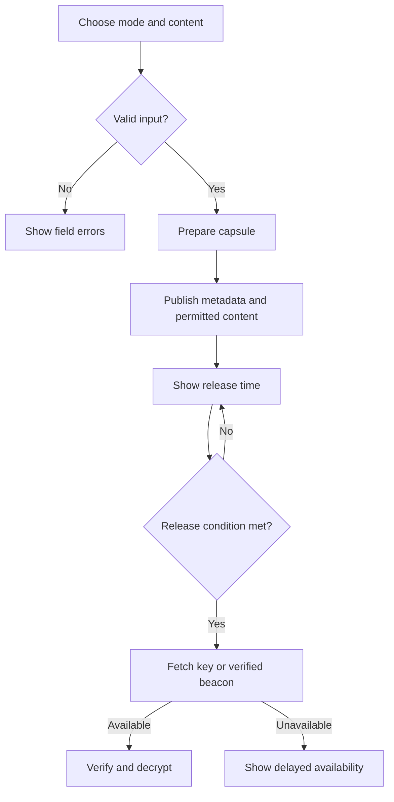

# Time capsules

## Purpose

Create text or file capsules with a public release date and an explicit secrecy mode.

## User stories

As an owner, I want this feature so that I can verify the release behavior before I trust the deployment.

## Functional requirements

- FR-capsules-1: The owner chooses public, server-held, or tlock mode before publication.
- FR-capsules-2: The upload rejects plaintext content larger than the configured limit.
- FR-capsules-3: The server-held mode withholds its key until the release time.
- FR-capsules-4: The tlock mode selects the first supported beacon round at or after the requested time.
- FR-capsules-5: The public page states the selected mode and its trust assumptions.
- FR-capsules-6: The owner exports a self-contained recovery bundle for an encrypted capsule.
- FR-capsules-7: The public page verifies content integrity before it offers a decrypted download.
- FR-capsules-8: The owner deletes local capsule content through an explicit confirmation.
- FR-capsules-9: The public page distinguishes release time from content availability.

## User flows

1. Choose the secrecy mode.
2. Enter the content and release time.
3. Review the trust assumptions.
4. Publish the capsule.
5. Export the recovery bundle.
6. At release, retrieve the required key or beacon.
7. Verify the content before the download.

## Screens & states

[Open the mockup](../mockups/capsules.html).

Empty: choose a mode. Pending: show upload progress. Sealed: show effective release time. Released: offer download. Error: show integrity or availability failure. Unauthorized: block edits.

## Behaviour rules

The default limit is 10 MiB of plaintext for each capsule. Accept text as UTF-8 or a file as opaque bytes.
Enforce a bounded ciphertext overhead limit before allocation. Limit text previews to 4096 bytes.
Use a fresh random content key for each encrypted capsule.
Use an established authenticated encryption format. Bind the capsule identifier and format version as associated data.
Server-held mode trusts the server operator. A server outage can delay that mode.
CLI tlock preparation occurs on the owner's machine. Web preparation passes plaintext through the server in v1.
State this difference before upload. Do not claim protection from an operator who sees plaintext during preparation.
Pin the beacon chain hash and public key in the bundle. Verify the beacon signature locally.
Store ciphertext, its digest, mode, format version, requested time, and effective time in the recovery bundle.
A published tlock bundle remains usable after deletion from the project. Renewal does not apply to fixed capsules.
Retain local released content until owner deletion. Show that public copies remain outside the owner's control.
Serve downloaded files as attachments. Serve active content from a separate origin or as opaque downloads.

## Data touched

Capsule, encrypted object, key reference, release manifest, beacon chain reference, audit event. Plaintext is transient during preparation.

## Interfaces

`POST /api/v1/capsules` accepts a bounded multipart upload with `{mode,release_at,title}` and returns 201.
`POST /api/v1/capsules/{id}/publish` returns 200 with the public manifest.
`GET /c/{id}` serves the public page.
`GET /api/v1/public/capsules/{id}/bundle` returns the recovery bundle.
`GET /api/v1/public/capsules/{id}/key` returns 425 before release in server-held mode.
`DELETE /api/v1/capsules/{id}` returns 204 after confirmation.
CLI: `epochalypse capsule create`, `publish`, `export`, `open`, and `delete`.
External candidate: [tlock v1.2.0 README](https://github.com/drand/tlock/blob/v1.2.0/README.md).
Current [drand security assumptions](https://docs.drand.love/docs/timelock-encryption/) apply.
The pinned README mixes legacy fastnet and quicknet examples. The compatibility spike verifies a chain explicitly.
No implementation may use a network default from an example without that check.

The API uses the shared error format in the project spec. Mutations require owner authorization unless this file states otherwise.

## Edge cases & failures

A missing beacon shows delayed availability. A corrupt object produces an integrity error without partial plaintext.
Reject release dates in the past at creation. Use UTC seconds for storage.
Reject unsupported format versions before decryption. A lost server-held key has no automatic recovery.
The export flow states whether it includes ciphertext only or an already released key.

## Acceptance criteria

Each criterion requires a test or a reproducible review record. The quoted behavior is the observable result.

- AC-capsules-1 covers FR-capsules-1: The owner chooses public, server-held, or tlock mode before publication.
- AC-capsules-2 covers FR-capsules-2: The upload rejects plaintext content larger than the configured limit.
- AC-capsules-3 covers FR-capsules-3: The server-held mode withholds its key until the release time.
- AC-capsules-4 covers FR-capsules-4: The tlock mode selects the first supported beacon round at or after the requested time.
- AC-capsules-5 covers FR-capsules-5: The public page states the selected mode and its trust assumptions.
- AC-capsules-6 covers FR-capsules-6: The owner exports a self-contained recovery bundle for an encrypted capsule.
- AC-capsules-7 covers FR-capsules-7: The public page verifies content integrity before it offers a decrypted download.
- AC-capsules-8 covers FR-capsules-8: The owner deletes local capsule content through an explicit confirmation.
- AC-capsules-9 covers FR-capsules-9: The public page distinguishes release time from content availability.

## Out of scope

Post-quantum secrecy, guaranteed long-term beacon availability, private recipient delivery, and cancellation of published tlock ciphertext.

## Open questions

The technical gates in the project spec apply. This feature has no additional product questions.
