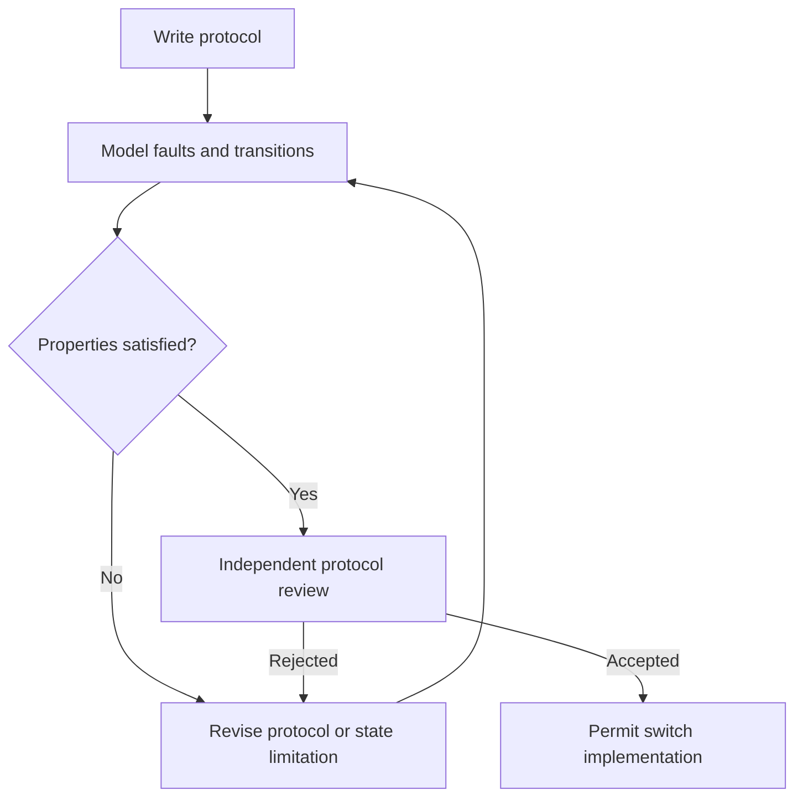

# Switch protocol review

## Purpose

Validate the release protocol before implementation makes an outage guarantee.

## User stories

As an owner, I want this feature so that I can verify the release behavior before I trust the deployment.

## Functional requirements

- FR-switch-protocol-1: The protocol defines a two-of-three release threshold.
- FR-switch-protocol-2: The protocol requires three durable acknowledgments for a successful renewal.
- FR-switch-protocol-3: The protocol binds each check-in to an increasing sequence number.
- FR-switch-protocol-4: The protocol rejects a renewal at or after the local release boundary.
- FR-switch-protocol-5: The review models partial renewal and lost acknowledgments.
- FR-switch-protocol-6: The review models old shares retained by public observers.
- FR-switch-protocol-7: The model releases content after main-server loss plus one agent outage.
- FR-switch-protocol-8: The review records a maintainer decision before production switch use.

## User flows

1. Define the fault model.
2. Specify every transition and message.
3. Explore the failure schedules.
4. Record counterexamples or supporting evidence.
5. Obtain a maintainer decision before production use.

## Screens & states

This feature has no dedicated screen. The CLI reports progress, success, and structured errors.

## Behaviour rules

The initial fault model permits one unavailable agent. It assumes honest agents with bounded clock error.
Two colluding agents can disclose a secret early. State this trust limit.
A renewal must reach all agents. One unavailable agent can prevent renewal even when release remains available.
A failed renewal leaves the old deadline as the owner's conservative deadline.
An agent can retain a later local deadline after a partial renewal. Show this uncertainty explicitly.
The review must establish whether partial renewal can delay release beyond the displayed confirmed deadline.
If the protocol cannot meet the required bound, propose a revised protocol for maintainer review.
Do not use a new threshold cryptography primitive without a maintained library and review.
Specify secure share distribution, authenticated transport, replay defense, and durable state before acknowledgment.
Specify backup rollback detection, released-share history, cancellation, and agent replacement.
Treat a partial release as irreversible. Later renewals cannot recall published shares.
Keep switch production use disabled until the review passes.

## Data touched

Protocol version, state model, counterexample schedules, decision record. This epic uses synthetic secrets only.

## Interfaces

Specify `prepare`, `arm`, `checkin`, `status`, and `release` message schemas.
Each signed message includes switch ID, protocol version, sequence, deadline, grace, and content digest.
Each receipt includes agent identity, accepted state, durable sequence, and signature.
Use canonical byte encoding with domain separation. The spike specifies the exact encoding.
Library selection and exact threshold APIs remain research outputs, not assumed external capabilities.

The API uses the shared error format in the project spec. Mutations require owner authorization unless this file states otherwise.

## Edge cases & failures

Crash before persistence, crash after persistence, lost response, replay, clock steps, concurrent renewal, and partition all need executable schedules.
A common provider, shared credential, or shared disk invalidates failure independence.

## Acceptance criteria

Each criterion requires a test or a reproducible review record. The quoted behavior is the observable result.

- AC-switch-protocol-1 covers FR-switch-protocol-1: The protocol defines a two-of-three release threshold.
- AC-switch-protocol-2 covers FR-switch-protocol-2: The protocol requires three durable acknowledgments for a successful renewal.
- AC-switch-protocol-3 covers FR-switch-protocol-3: The protocol binds each check-in to an increasing sequence number.
- AC-switch-protocol-4 covers FR-switch-protocol-4: The protocol rejects a renewal at or after the local release boundary.
- AC-switch-protocol-5 covers FR-switch-protocol-5: The review models partial renewal and lost acknowledgments.
- AC-switch-protocol-6 covers FR-switch-protocol-6: The review models old shares retained by public observers.
- AC-switch-protocol-7 covers FR-switch-protocol-7: The model releases content after main-server loss plus one agent outage.
- AC-switch-protocol-8 covers FR-switch-protocol-8: The review records a maintainer decision before production switch use.

## Out of scope

Claims of Byzantine fault tolerance and release after all three agents disappear.

## Open questions

The technical gates in the project spec apply. This feature has no additional product questions.
