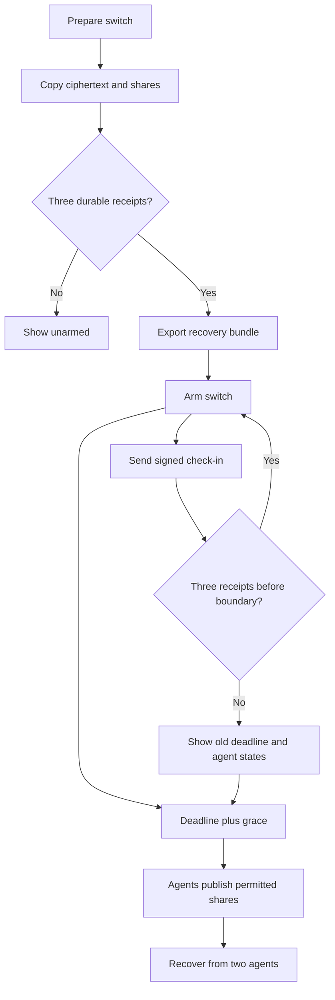

# Dead man’s switches

## Purpose

Release replicated encrypted content after missed check-ins despite main-server loss.

## User stories

As an owner, I want this feature so that I can verify the release behavior before I trust the deployment.

## Functional requirements

- FR-switches-1: The owner configures a check-in interval and grace period.
- FR-switches-2: The owner arms a switch only after all three agents confirm durable content.
- FR-switches-3: The owner sends signed check-ins directly to each agent.
- FR-switches-4: The interface reports renewal success only after three durable receipts.
- FR-switches-5: The agents release shares after their accepted deadline plus grace.
- FR-switches-6: The public recovery client reconstructs a key from two valid release shares.
- FR-switches-7: The recovery client retrieves ciphertext without the main server.
- FR-switches-8: The interface reports each agent receipt independently.
- FR-switches-9: The owner exports a recovery bundle before the switch becomes armed.
- FR-switches-10: The deployment test stops the main server plus one agent before release.

## User flows

1. Choose an interval and grace period.
2. Replicate the encrypted content to all agents.
3. Verify the three durable receipts.
4. Export the recovery bundle.
5. Arm the switch.
6. Send check-ins before the deadline.
7. If renewal lacks a receipt, use the old deadline as the conservative boundary.
8. After release, recover the content from two agents.

## Screens & states

[Open the mockup](../mockups/switches.html).

Empty: explain the switch. Draft: show missing replicas. Armed: show confirmed deadline. Degraded: show missing receipts. Released: show recovery links. Unauthorized: block mutations.

## Behaviour rules

This feature depends on acceptance of the protocol review. Its rules defer to the reviewed protocol where the review identifies unsafe transitions.
Default interval: 24 hours. Default grace: 1 hour. Allow intervals from 1 hour to 365 days.
Allow grace from zero to 30 days. Show deadline and grace separately in UTC and the browser's local time.
Set a new deadline from the signed check-in issue time plus the configured interval.
Reject check-ins whose issue time exceeds the reviewed clock tolerance.
A DNS query never renews a switch. Automated main-server check-ins do not establish owner presence.
Require an owner signing key for direct check-ins. Store a web-use key only after the owner accepts its weaker host-compromise model.
The CLI supports a locally held signing key. Scoped API tokens alone cannot forge direct agent check-ins.
Each agent stores a complete ciphertext copy and one distinct key share.
The bundle contains all agent endpoints, identities, content digests, and public verification material.
Each agent serves public recovery data independently. Public recovery needs no owner authentication.
Provide a standalone recovery CLI. Main-server DNS availability is not a recovery dependency.
Show release as irreversible. Agent decommission or cancellation requires the reviewed protocol.
Use the same 10 MiB content limit and local retention rule as capsules.

## Data touched

Switch, agent, share reference, encrypted object, receipt, check-in sequence, audit event. Agents store independent state.

## Interfaces

`POST /api/v1/switches` creates a draft and returns 201.
`POST /api/v1/switches/{id}/arm` returns 200 only after the reviewed arm protocol succeeds.
Agent `POST /agent/v1/switches/{id}/checkins` accepts a signed message and returns a signed receipt.
Agent `GET /agent/v1/public/switches/{id}` returns the manifest and permitted release material.
`GET /api/v1/switches/{id}` returns confirmed and per-agent states.
CLI: `epochalypse switch create`, `arm`, `checkin`, `status`, `export`, and `recover`.
The protocol review defines exact body fields and boundary semantics before these routes ship.

The API uses the shared error format in the project spec. Mutations require owner authorization unless this file states otherwise.

## Edge cases & failures

A network partition can trigger release despite an available owner. Explain this before arm confirmation.
A failed renewal never shows a green success state.
An unavailable agent prevents full renewal. Two available agents still support release under the reviewed fault model.
A disk rollback or excessive clock uncertainty removes the agent from readiness until the reviewed recovery procedure completes.

## Acceptance criteria

Each criterion requires a test or a reproducible review record. The quoted behavior is the observable result.

- AC-switches-1 covers FR-switches-1: The owner configures a check-in interval and grace period.
- AC-switches-2 covers FR-switches-2: The owner arms a switch only after all three agents confirm durable content.
- AC-switches-3 covers FR-switches-3: The owner sends signed check-ins directly to each agent.
- AC-switches-4 covers FR-switches-4: The interface reports renewal success only after three durable receipts.
- AC-switches-5 covers FR-switches-5: The agents release shares after their accepted deadline plus grace.
- AC-switches-6 covers FR-switches-6: The public recovery client reconstructs a key from two valid release shares.
- AC-switches-7 covers FR-switches-7: The recovery client retrieves ciphertext without the main server.
- AC-switches-8 covers FR-switches-8: The interface reports each agent receipt independently.
- AC-switches-9 covers FR-switches-9: The owner exports a recovery bundle before the switch becomes armed.
- AC-switches-10 covers FR-switches-10: The deployment test stops the main server plus one agent before release.

## Out of scope

Email or SMS delivery, automatic proof of death, anonymous agent enrollment, and guaranteed recovery after all agents disappear.

## Open questions

The technical gates in the project spec apply. This feature has no additional product questions.
