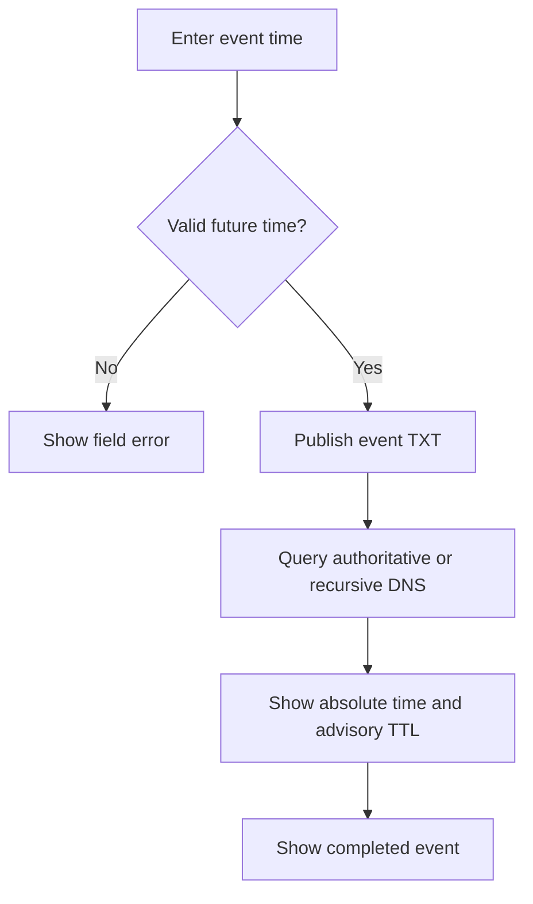

# DNS countdowns

## Purpose

Expose an event time through DNS with an advisory TTL countdown and a reliable absolute timestamp.

## User stories

As an owner, I want this feature so that I can verify the release behavior before I trust the deployment.

## Functional requirements

- FR-countdowns-1: The owner creates a countdown with an absolute event time.
- FR-countdowns-2: The authoritative TTL equals remaining whole seconds within the supported range.
- FR-countdowns-3: The TXT record contains the absolute event time.
- FR-countdowns-4: The public page computes its countdown from the absolute event time.
- FR-countdowns-5: The public page shows a completed state at the event time.
- FR-countdowns-6: The interface labels recursive TTL values as advisory.

## User flows

1. Enter the event time.
2. Publish the countdown.
3. Query its TXT record.
4. Read the absolute timestamp.
5. At the event time, inspect the completed state.

## Screens & states

[Open the mockup](../mockups/countdowns.html).

Empty: create event. Pending: publish event. Active: show event time. Complete: show completion. Error: show time-sync status. Unauthorized: block edits.

## Behaviour rules

Compute `max(0, floor(event_time - authoritative_now))`.
Cap the TTL at 2147483647 seconds. Reject initial events beyond that horizon in v1.
Use TTL zero at and after the event. Retain the TXT event timestamp until owner deletion.
Use a static event TXT RRset with a signed original TTL at least as large as the emitted TTL.
Keep signature validity independent of the event boundary. Renew ordinary signatures before expiration.
Verify the TTL signature rule through the resolver lab before production use.
A recursive resolver can cap TTL, prefetch, or serve stale data. Never use TTL as a security boundary.
The web page resynchronizes time from the server after sleep. Show an unavailable-time state if synchronization fails.

## Data touched

Countdown: identifier, title, event time, DNS name, state. Public metadata contains no secret.

## Interfaces

`POST /api/v1/countdowns` accepts `{title,event_at}` and returns 201.
`GET /events/{id}` serves the public page.
`DELETE /api/v1/countdowns/{id}` returns 204.
CLI: `epochalypse countdown create` and `inspect`.
DNS TXT: `v=epochalypse1 event=<UTC timestamp>`.
Sources: [RFC 4035 section 5.3.3](https://www.rfc-editor.org/rfc/rfc4035.html), TTL limits during validation;
[RFC 8767](https://www.rfc-editor.org/rfc/rfc8767/), stale answers.

The API uses the shared error format in the project spec. Mutations require owner authorization unless this file states otherwise.

## Edge cases & failures

Clock changes recompute the advisory TTL. Resolver caps produce a different TTL without changing the event time.

## Acceptance criteria

Each criterion requires a test or a reproducible review record. The quoted behavior is the observable result.

- AC-countdowns-1 covers FR-countdowns-1: The owner creates a countdown with an absolute event time.
- AC-countdowns-2 covers FR-countdowns-2: The authoritative TTL equals remaining whole seconds within the supported range.
- AC-countdowns-3 covers FR-countdowns-3: The TXT record contains the absolute event time.
- AC-countdowns-4 covers FR-countdowns-4: The public page computes its countdown from the absolute event time.
- AC-countdowns-5 covers FR-countdowns-5: The public page shows a completed state at the event time.
- AC-countdowns-6 covers FR-countdowns-6: The interface labels recursive TTL values as advisory.

## Out of scope

Exact recursive TTL guarantees and per-second updates to a static zone file.

## Open questions

The technical gates in the project spec apply. This feature has no additional product questions.
