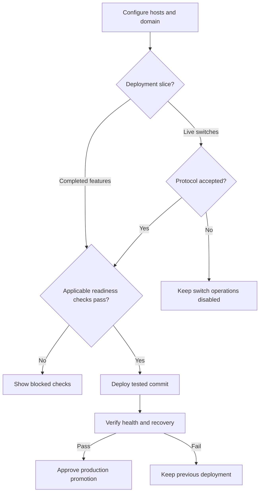

# Deployment and recovery

## Purpose

Provide a provider-neutral Linux deployment with independent recovery paths and measurable health.

## User stories

As an owner, I want this feature so that I can verify the release behavior before I trust the deployment.

## Functional requirements

- FR-operations-1: The deployment guide supports local containers and Linux VPS hosts.
- FR-operations-2: The readiness check reports shared failure domains across agents.
- FR-operations-3: The backup test restores state into an isolated deployment.
- FR-operations-4: The release test recovers a file after main-server loss plus one agent outage.
- FR-operations-5: The operator promotes a tested commit from `dev` to `main` through a separate approval.
- FR-operations-6: The deployment status command verifies the requested commit on every required service.
- FR-operations-7: The deployment guide documents DNSSEC delegation checks.
- FR-operations-8: The operator can retrieve public recovery data directly from an agent.

## User flows

1. Configure the hosts and domain.
2. Run readiness checks.
3. Deploy the tested commit to a staging environment.
4. Run the applicable feature recovery exercise.
   Run live switch exercises only after protocol acceptance.
5. Approve production promotion.
6. Verify the deployed commit.

## Screens & states

This feature has no dedicated screen. The CLI reports progress, success, and structured errors.

## Behaviour rules

Deploy completed DNSSEC, capsule, and countdown features without switch protocol acceptance.
Verify the main service commit, applicable health checks, backups, and feature recovery for this deployment slice.
Keep switch-specific readiness, live-agent restoration, and switch recovery drills behind protocol acceptance.
For the later switch reference deployment, use a main Linux VPS and three independently reachable agents.
The live switch drill verifies recovery by Bmax plus E under the reviewed clock and publication assumptions.
Place agents across three failure domains. Owner-operated and trusted-operator layouts use the same protocol.
Use TLS for HTTPS. Pin agent identities independently of DNSSEC.
Expose DNS over UDP and TCP port 53. Expose public recovery over HTTPS port 443.
Keep administrative and agent-control ports private where public access is unnecessary.
Use persistent disks, per-service identities, resource limits, and bounded request bodies.
Provide systemd units and container examples. A managed platform qualifies only if it provides the required ports and durable state.
Use atomic state updates with fsync before receipts. The foundation spike chooses the maintained durable store.
Backups contain encrypted content and sensitive shares. Encrypt backups with separate operator-controlled keys.
Restore procedures preserve monotonic state. Never restore a live agent from a stale backup without the reviewed recovery protocol.
DNSSEC setup requires a delegated zone or subdomain, DNSKEY publication, and parent DS coordination.
Do not purchase hosts or register a domain during planning.
Budget remains unspecified. Document resource measurements before recommending a paid deployment.
Use separate DNS recovery names or independently available endpoints for agents.

## Data touched

Deployment manifest, service commit IDs, readiness results, backup metadata, agent identities. Keep real host values outside the public spec.

## Interfaces

`GET /healthz` reports process liveness.
`GET /readyz` reports state-store, clock, and configuration readiness.
`GET /version` reports the commit and format versions without credentials.
`scripts/deploy-status.sh <sha>` reports the normalized deployment status.
`scripts/recovery-drill.sh` uses synthetic content only.
Provider-specific APIs remain outside v1. The operator supplies hosts through documented configuration.

The API uses the shared error format in the project spec. Mutations require owner authorization unless this file states otherwise.

## Edge cases & failures

If a provider blocks UDP 53, the DNS readiness check fails.
If all agents stop, the initial switch guarantee no longer applies.
If the beacon stops, tlock capsule availability can fail even while the main server works.
Rollback code only when persistent formats remain compatible. Never roll back agent state.

## Acceptance criteria

Each criterion requires a test or a reproducible review record. The quoted behavior is the observable result.

- AC-operations-1 covers FR-operations-1: The deployment guide supports local containers and Linux VPS hosts.
- AC-operations-2 covers FR-operations-2: The readiness check reports shared failure domains across agents.
- AC-operations-3 covers FR-operations-3: The backup test restores state into an isolated deployment.
- AC-operations-4 covers FR-operations-4: The release test recovers a file after main-server loss plus one agent outage.
- AC-operations-5 covers FR-operations-5: The operator promotes a tested commit from `dev` to `main` through a separate approval.
- AC-operations-6 covers FR-operations-6: The deployment status command verifies the requested commit on every required service.
- AC-operations-7 covers FR-operations-7: The deployment guide documents DNSSEC delegation checks.
- AC-operations-8 covers FR-operations-8: The operator can retrieve public recovery data directly from an agent.

- AC-operations-9 covers FR-operations-1: Completed-feature deployment proceeds without agents or switch protocol acceptance.
- AC-operations-10 covers FR-operations-4: Live switch drills remain disabled until the revised model and independent protocol review pass.

## Out of scope

Infrastructure purchases, provider-specific provisioning APIs, and a managed multi-tenant service.

## Open questions

The technical gates in the project spec apply. This feature has no additional product questions.
