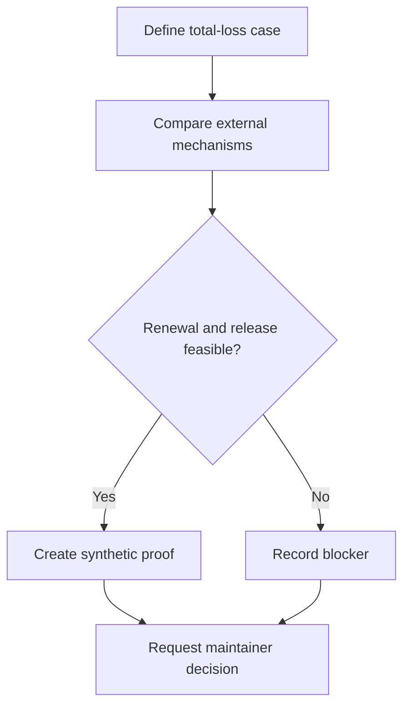

# External release research

## Purpose

Assess release after every project-operated server disappears without weakening the renewable check-in requirement.

## User stories

As an owner, I want this feature so that I can verify the release behavior before I trust the deployment.

## Functional requirements

- FR-research-1: The report compares fixed tlock capsules with renewable switches.
- FR-research-2: The report evaluates an external execution network for deadline enforcement.
- FR-research-3: The report defines independent ciphertext availability requirements.
- FR-research-4: The report evaluates cost, trust, censorship, and network failure.
- FR-research-5: The report contains a reproducible synthetic proof of concept or a documented blocker.
- FR-research-6: The report requests a maintainer decision before any new service dependency.

## User flows

1. Define which infrastructure disappears.
2. Compare candidate mechanisms.
3. Test the renewal and release properties.
4. Record operational costs and trust.
5. Present the decision to the maintainer.

## Screens & states

This feature has no dedicated screen. The CLI reports progress, success, and structured errors.

## Behaviour rules

Treat the loss of all owner-operated hosts separately from the loss of all independent operators.
Evaluate external threshold custodians and externally executed contracts as candidates, not approved dependencies.
A public fixed-time ciphertext cannot support revocation by a later check-in.
Evaluate observer-retained ciphertext and stale state in every candidate.
Include storage persistence, key release, retrieval, and a client that survives main-server loss.
Limit the initial report to five focused days. Record a blocker instead of introducing unreviewed cryptography.
Fetch current primary documentation for every candidate before the comparison names a supported capability.

## Data touched

Research report and synthetic fixtures. No real secret or paid service.

## Interfaces

No production interface changes. The report proposes any new interface with documentation and a pinned version.

The API uses the shared error format in the project spec. Mutations require owner authorization unless this file states otherwise.

## Edge cases & failures

An unavailable execution network or ciphertext store can prevent recovery. A smart contract alone does not provide private key custody.

## Acceptance criteria

Each criterion requires a test or a reproducible review record. The quoted behavior is the observable result.

- AC-research-1 covers FR-research-1: The report compares fixed tlock capsules with renewable switches.
- AC-research-2 covers FR-research-2: The report evaluates an external execution network for deadline enforcement.
- AC-research-3 covers FR-research-3: The report defines independent ciphertext availability requirements.
- AC-research-4 covers FR-research-4: The report evaluates cost, trust, censorship, and network failure.
- AC-research-5 covers FR-research-5: The report contains a reproducible synthetic proof of concept or a documented blocker.
- AC-research-6 covers FR-research-6: The report requests a maintainer decision before any new service dependency.

## Out of scope

A production external execution network and guarantees against loss of every external dependency.

## Open questions

The technical gates in the project spec apply. This feature has no additional product questions.
