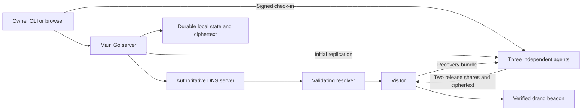
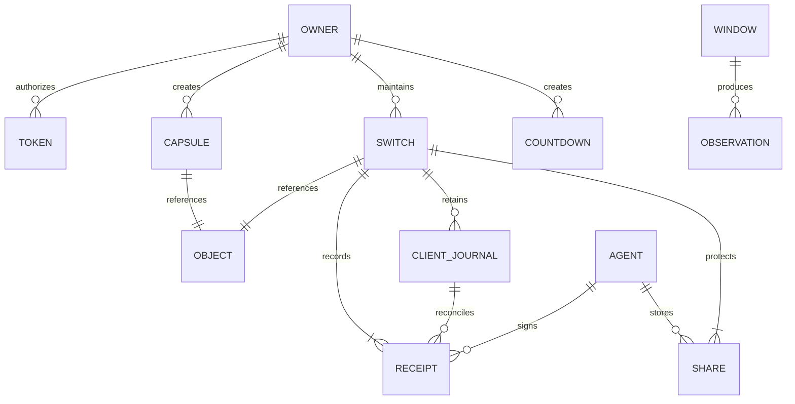
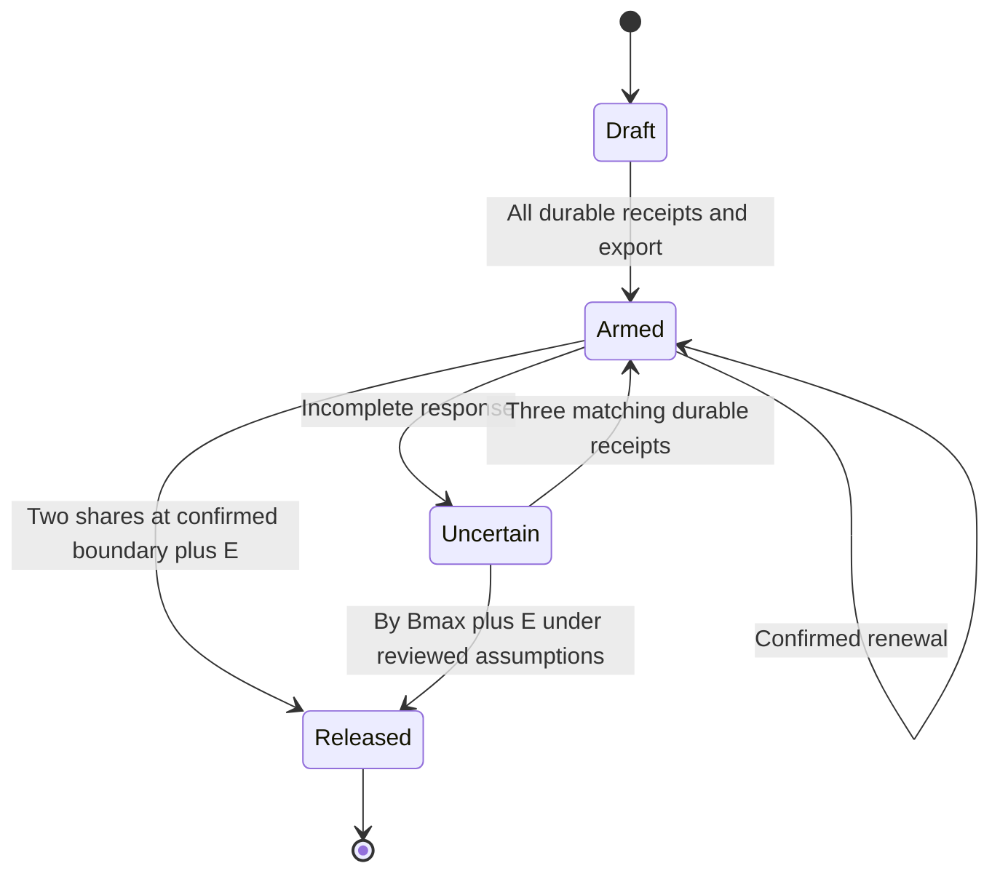

# epochalypse

## Overview

epochalypse provides time capsules, renewable dead man’s switches, and DNS countdowns.
Developers use a Go CLI and a resolver lab. Individuals use an owner dashboard and public release pages.
The project supports local containers and Linux VPS hosts.

DNSSEC signature windows demonstrate validator behavior. They do not keep published data secret.
Encrypted capsules use server-held keys or a verified drand beacon.
Independent agents support switch release after the main server fails.

The owner states: “outage shouldnt stop this as it undermines the entire deadman switch behavior.”
The accepted direction covers main-server loss plus one unavailable agent by Bmax plus the reviewed allowance E.
After incomplete receipts, the client reports uncertainty from B0 through Bmax. B0 is the earliest possible disclosure boundary.
Three durable receipts confirm renewal. No replacement protocol has production acceptance.
See [ADR 0012](../adr/0012-switch-uncertainty.md) and the [direction report](../research/switch-protocol/directions.md).
A separate research epic assesses loss of all project-operated servers.

## Terms

| Term | Part of speech | Meaning in this project | Do not use |
|---|---|---|---|
| project | noun | The epochalypse software and its specifications. | app |
| owner | noun | The single administrator of an installation. | tenant |
| visitor | noun | A person who reads public content. | anonymous owner |
| agent | noun | An independent service that stores switch state and a key share. | worker |
| capsule | noun | Content with a fixed release time. | vault |
| switch | noun | Content with a renewable release deadline. | capsule when renewal applies |
| countdown | noun | A public event time with an advisory DNS TTL. | timer |
| window | noun | A DNSSEC signature inception and expiration pair. | secrecy lock |
| deadline | noun | The latest accepted owner check-in boundary. | expiration |
| grace | noun | The duration between the deadline and release eligibility. | timeout |
| release boundary | noun | The deadline plus grace for one accepted state. | deadline alone |
| B0 | noun | The last release boundary confirmed by three matching durable receipts; the earliest possible disclosure after uncertain renewal. | exact authority after receipt loss |
| Bmax | noun | The latest release boundary in any owner-signed renewal already issued for transmission. | latest received receipt |
| E | noun | The reviewed allowance for clock error and publication work. ADR 0013 accepts candidate E=34 seconds for implementation, subject to actual-host verification. | exact UTC guarantee |
| uncertain outcome | noun | An incomplete response that can hide partial or complete renewal acceptance. | failed renewal |
| client journal | noun | Durable signed intent stored before transmission, including exact bytes, sequence, deadline, and proposed boundary. | memory-only retry |
| share | noun | One agent's part of the content key. | whole key |
| receipt | noun | A signed acknowledgment of durable agent state. | success hint |
| recovery bundle | noun | Exported data needed for independent content recovery. | backup alone |
| manifest | noun | Versioned public content and release metadata. | payload |
| check-in | noun | A signed owner request to extend a switch deadline. | DNS query |
| ciphertext | noun | Encrypted content. | hidden TXT |
| beacon | noun | A publicly verifiable drand round signature. | arbitrary randomness |
| DNS | noun | Domain Name System. | name database |
| DNSSEC | noun | DNS Security Extensions. | encryption |
| DNSKEY | noun | A DNS record that contains a public DNSSEC key. | private key |
| key tag | noun | A 16-bit checksum that identifies a DNSKEY candidate; different keys can have the same value. | unique key identifier |
| RRSIG | noun | A DNS record that carries a signature and its time window. | key |
| RRset | noun | DNS records with one owner name, class, and type. | arbitrary record group |
| TXT | noun | The DNS text record type. | text file |
| TTL | noun | Time to live, in seconds, in a DNS response. | release guarantee |
| AD | noun | Authentic Data flag in a DNS response. | secrecy flag |
| CD | noun | Checking Disabled flag in a DNS query. | lock bypass exploit |
| UTC | noun | Coordinated Universal Time. | local stored time |
| CLI | noun | Command-line interface. | terminal dashboard |
| API | noun | Application programming interface. | unspecified endpoint |
| HTTP | noun | Hypertext Transfer Protocol. | transport security |
| HTTPS | noun | HTTP protected by TLS. | plain HTTP |
| TLS | noun | Transport Layer Security. | DNSSEC |
| CSRF | noun | Cross-site request forgery. | authentication |
| VPS | noun | Virtual private server. | managed service guarantee |
| CI | noun | Continuous integration checks. | coverage alone |
| JWE | noun | JSON Web Encryption compact serialization for authenticated capsule content. | unframed ciphertext |
| TDD | noun | Test-driven development through fail, pass, and refactor steps. | tests after behavior only |
| E2E | noun | End-to-end verification through public interfaces. | unit test |
| create | verb | Make a new entity. | provision when entity creation applies |
| arm | verb | Activate a switch after the required durable receipts. | publish before ready |
| renew | verb | Extend a switch through the reviewed check-in protocol. | reset |
| release | verb | Make sufficient recovery material public. | delete |
| recover | verb | Retrieve and decrypt content through the recovery path. | restore agent state |
| delete | verb | Remove a local copy under owner control. | recall public copies |

## Goals

- Provide all three variants through a CLI and web pages.
- Demonstrate future-signature behavior through real validating resolvers.
- Distinguish validation, confidentiality, and availability in every release mode.
- Recover switch content after main-server loss plus one agent outage.
- Pass every required test before merge.
- Maintain at least 90.00 percent aggregate statement coverage for first-party Go code.
- Record a reproducible total-loss research result.

## Non-goals

V1 excludes multiple owner accounts, billing, and a managed hosted service.
Future work includes multiple accounts with separate dashboards.
V1 excludes exact-time acceptance by arbitrary resolvers and secrecy from public RRSIG windows.
V1 does not guarantee switch recovery after every agent disappears.
V1 does not claim resistance to collusion by two agents or a compromised preparation client.

## Users & personas

| Persona | Need | Permission |
|---|---|---|
| Owner | Create content and maintain switches. | Authenticated administration and signed check-ins. |
| Visitor | Read released content. | Public read and recovery only. |
| Researcher | Compare resolver behavior. | Owner-created lab experiments. |
| Agent operator | Maintain an independent release service. | Agent host administration, not owner administration. |

## Feature map

| Feature | Spec | Epic | Mockup |
|---|---|---|---|
| Foundation | [foundation](features/00-foundation.md) | Epic 0: Foundation | None |
| DNSSEC signature windows | [dns-window](features/01-dns-window.md) | Epic 1: DNSSEC lab | [dns-window](mockups/dns-window.html) |
| Owner access | [owner](features/02-owner.md) | Epic 2: Owner access | [owner](mockups/owner.html) |
| Time capsules | [capsules](features/03-capsules.md) | Epic 3: Time capsules | [capsules](mockups/capsules.html) |
| Switch protocol review | [switch-protocol](features/04-switch-protocol.md) | Epic 4: Switch protocol review | None |
| Dead man’s switches | [switches](features/05-switches.md) | Epic 5: Dead man’s switches | [switches](mockups/switches.html) |
| DNS countdowns | [countdowns](features/06-countdowns.md) | Epic 6: DNS countdowns | [countdowns](mockups/countdowns.html) |
| Deployment and recovery | [operations](features/07-operations.md) | Epic 7: Deployment and recovery | None |
| External release research | [research](features/08-research.md) | Epic 8: External release research | None |

Mockups communicate interface intent. Functional requirements and acceptance criteria define behavior.

## Architecture & stack

Use Go 1.27.3 with standard HTTP, templates, JSON, and CLI flags.
The [Go release history](https://go.dev/doc/devel/release) documents this version and its security fixes.
Use server-rendered HTML with a small local JavaScript layer. The web interface requires no external frontend service.
Use `cmd/epochalypse` for the executable and `internal/` for domain modules.
Separate modules cover authentication, DNS, capsules, switches, agent state, content, and the clock.
Use injected clocks for deterministic tests. Use monotonic durations for local scheduling, with explicit UTC release boundaries.

Use [codeberg.org/miekg/dns v0.6.128](https://pkg.go.dev/codeberg.org/miekg/dns@v0.6.128) for the authoritative server and DNS clients.
Keep [miekg/dns v1.1.73](https://github.com/miekg/dns/tree/v1.1.73) as an isolated comparison dependency.
The [compatibility report](../research/dns-compatibility.md) records real resolver evidence and API limits.
ADR 0004 records the choice. The implemented contracts are in docs/windows.md and docs/observations.md.
The tlock v1.2.0 compatibility report verifies an explicit quicknet identity.
Use docs/research/tlock-compatibility.md before production integration; example defaults have no authority.
Owner state uses bbolt v1.5.0 and Argon2id from golang.org/x/crypto v0.58.0.
ADR 0003 and docs/owner.md define the verified storage and password contracts.
The foundation pins the lint tools in its check scripts.
Use the pinned HashiCorp Shamir package for two-of-three switch key shares under the reviewed content and authenticated recovery contracts.
The switch runtime guide records its scoped license and dependency decision.

Use provider-neutral Linux services and container examples. Managed platforms must meet port and state requirements.
Each agent provides its own public recovery endpoint and durable ciphertext copy.
The main server is absent from the switch recovery path.

## Data model

| Entity | Fields and constraints | Lifecycle |
|---|---|---|
| Owner | Random ID, password hash, creation time; exactly one. | Initial setup through local recovery. |
| Token | ID, digest, scopes, expiry, revocation time. | Active to expired or revoked. |
| Capsule | ID, title, mode, requested time, effective time, object digest, format version. | Draft, sealed, available, deleted. |
| Object | Digest, byte count, media type, encrypted bytes, format version. | Prepared to retained or locally deleted. |
| Switch | ID, owner public key, interval, grace, sequence, confirmed state, B0, Bmax, allowance assumptions, object digest. | Draft, armed, uncertain, released. |
| Client journal | Switch ID, exact signed bytes, sequence, deadline, proposed boundary, receipt evidence. | Durable before transmission; retained through reconciliation. |
| Agent | ID, public key, endpoints, failure domain, protocol version. | Enrolled to ready, unavailable, or retired. |
| Share | Switch ID, agent ID, content key reference, encrypted share, irreversible release history. | Private to irreversibly public; observer copies persist. |
| Receipt | Agent ID, switch ID, sequence, deadline, digest, signature. | Append-only evidence. |
| Countdown | ID, title, event time, DNS name. | Active, completed, deleted. |
| Window | ID, zone, content, inception, expiration, key reference. | Draft, published, expired. |
| Observation | Window ID, resolver version, clock offset, query flags, response, observation time. | Immutable lab result. |

Use UTC integer seconds for protocol times. Use bounded integer durations for intervals and grace.
Keep owner content keys separate from public metadata. Give each agent a distinct share.
Version persistent formats. Validate migrations against preserved fixtures before rollout.

## Cross-cutting concerns

Authenticate mutations. Authorize each token scope. Sign direct check-ins with an owner key.
Use TLS outside the isolated local lab. Require anti-replay checks on agent messages.
Use generic authentication errors and specific validation errors.
The API error shape is `{error:{code,message,fields,request_id}}`.
Use 400 for malformed input, 401 for missing authentication, and 403 for insufficient scope.
Use 404 for absent public objects, 409 for state conflicts, 413 for size limits, and 429 for rate limits.
Use 503 for an unavailable dependency. Use 425 for a server-held key before release.
Use request IDs across logs. Exclude plaintext, passwords, tokens, private keys, and key shares from logs.
Bound request time, memory, disk quotas, and concurrent work. Default to 100 retained objects and 1 GiB per installation.
The owner can change storage quotas. Failed quota checks leave no armed switch.

Use keyboard-accessible controls, semantic labels, visible focus, and textual state labels.
Support responsive light and dark layouts. Use English copy in v1.
Show UTC with a local-time display. Never derive release authority from a visitor's browser clock.
Target a local p95 below 250 ms for metadata reads at 20 requests per second on a two-core host.
Exclude uploads and cryptographic preparation from that latency target. Record the benchmark host and workload.
Treat this target as a benchmark gate before release, not a claim about arbitrary VPS hosts.

## Environments & config

Environments are `lab`, `test`, `staging`, and `production`.
Synthetic demo content uses the `demo` namespace. CI never needs real owner credentials.
Use a versioned configuration file for structured agent and DNS settings.
Use these environment variables for process-level configuration:

| Name | Purpose | Default |
|---|---|---|
| EPOCHALYPSE_ENV | Select environment. | lab |
| EPOCHALYPSE_CONFIG | Locate the relative configuration file. | config/local.json |
| EPOCHALYPSE_STATE_DIR | Locate durable state. | var/state |
| EPOCHALYPSE_HTTP_ADDR | Bind the web listener. | 127.0.0.1:8080 |
| EPOCHALYPSE_DNS_ADDR | Bind UDP and TCP DNS. | 127.0.0.1:1053 |
| EPOCHALYPSE_PUBLIC_URL | Set the public origin. | http://localhost:8080 in lab |
| EPOCHALYPSE_AGENT_ID | Select an agent identity. | Required for agent mode |
| EPOCHALYPSE_KEY_FILE | Locate a protected key file. | Required when a private key applies |
| EPOCHALYPSE_MAX_UPLOAD_BYTES | Limit plaintext content. | 10485760 |
| EPOCHALYPSE_MAX_OBJECTS | Limit retained objects. | 100 |
| EPOCHALYPSE_QUOTA_BYTES | Limit retained local content. | 1073741824 |
| EPOCHALYPSE_LOG_LEVEL | Set log detail. | info |

Configuration holds the zone name, agent endpoints, failure domains, public keys, beacon chain, and protocol version.
Configure distinct subdomains and signing-key references for signature-window experiments and countdowns.
Countdown record names derive from their opaque identifiers under the configured countdown subdomain.
Return the actual record name in public metadata. The project does not change delegation automatically.
Private key files require owner-only filesystem access. Configuration contains key references rather than key values.
Production startup rejects lab keys and insecure public origins.
Use a small synthetic capsule, switch, countdown, and window as demo records.
Real domains, VPS addresses, and the personal GitHub identity remain operator setup values.
No provider budget or spending authority exists.

## Testing strategy

Required pass rate is 100 percent. Coverage is a separate minimum of 90.00 percent.
Measure Go statement coverage across every first-party production package, including CLI and HTTP adapters.
Exclude dependencies and generated third-party code. Do not exclude difficult branches to reach the threshold.
Fail the coverage check when the profile is absent, empty, malformed, or below the unrounded threshold.
Require explicit tests for every security and deadline boundary regardless of coverage.

Use TDD for behavior changes. First demonstrate a failing assertion against the existing behavior.
Then implement the smallest change that passes. Refactor while the checks remain green.
A new test that fails only because of a syntax error does not demonstrate the behavior.
Record the fail/pass commands in the PR description without mandatory changelog edits.

Planned commands become executable in Epic 0:

| Command | Required result |
|---|---|
| `make test-unit` | Unit tests pass with fake clocks and temporary state. |
| `make test-integration` | Real listeners, durable stores, and three agents pass. |
| `make test-e2e` | Browser and CLI happy paths plus critical errors pass. |
| `make test-resolvers` | Pinned default Unbound, strict Unbound, and BIND scenarios pass. |
| `make test-race` | `go test -race ./...` reports no races. |
| `make coverage` | Instrumented aggregate Go coverage reaches 90.00 percent. |
| `make fuzz-smoke` | Bounded parser and protocol fuzz tests pass for 30 seconds each. |
| `make lint` | Format, vet, complexity, nesting, dead-code, and security checks pass. |
| `make build` | Linux amd64 and arm64 builds succeed. |
| `make check` | All required checks above pass. |

Unit tests cover validation, authorization, TTL arithmetic, round selection, and state transitions.
Integration tests cover durable receipts, restarts, uploads, replication, and verified decryption.
E2E tests cover owner setup, sign-in, creation, publication, check-in, and independent recovery.
Test empty, active, unavailable, released, invalid, and unauthorized states.
Resolver tests cover trust chains, CD, direct queries, skew, bogus caches, expiry, truncation, and TCP.
Test clocks before, at, and after each boundary. Test backward and forward clock changes.
Test partial renewal, late renewal, lost replies, stale backups, repeated requests, and parallel check-ins.
Test corrupted ciphertext, signatures, shares, and beacon responses without partial plaintext output.
Stop the main server and one agent before the switch boundary. Recover through the remaining agents.
Live public beacon probes remain optional diagnostics. Deterministic verified fixtures gate CI.
Separate scheduled extended fuzz and fault runs from required short PR checks.
A skipped required test fails CI. Retries cannot turn a flaky first failure into a passing required result without diagnosis.

## Epics

Each epic maps to one integration batch. The estimates describe three to six focused changes per batch.
Research can return a blocker without enabling unsafe production behavior.

| Epic | Estimated focused days | Depends on | Exit criterion |
|---|---|---|---|
| Epic 0: Foundation | 5 | None | A fresh clone can check, build, and start the lab. |
| Epic 1: DNSSEC lab | 5 | 0 | The resolver matrix demonstrates the public window. |
| Epic 2: Owner access | 4 | 0 | Owner sessions and scoped tokens protect mutations. |
| Epic 3: Time capsules | 6 | 1, 2 | All three modes pass recovery tests. |
| Epic 4: Switch protocol review | 5 | 0 | The model and maintainer decision permit implementation. |
| Epic 5: Dead man’s switches | 6 | 2, 4 | Independent recovery passes the stated outage test. |
| Epic 6: DNS countdowns | 3 | 1, 2 | Signed countdown records pass resolver tests. |
| Epic 7: Deployment and recovery | 5 | 3, 6; switch slice also 5 | Completed features pass staging; switch drills await protocol acceptance. |
| Epic 8: External release research | 5 | 0; independent of production switch acceptance | The report supports a maintainer decision. |

Feature files define each epic's complete behavior. Split an epic before issue creation if the work exceeds six focused changes.
Do not compress the protocol review to preserve an estimate.

## Milestones

### First usable local milestone

On 2026-11-05, the owner selects these completed features in `dev` for the first usable local milestone:

- DNSSEC experiments.
- Time capsules.
- Countdowns.
- Owner access.

Provide these deliverables:

- Verified local startup.
- A synthetic walkthrough.
- The required test evidence.

Switch runtime work and its dependent deployment exercises belong to a later milestone.
Preserve these switch artifacts:

- The requirements.
- The reviewed protocol.
- The parked implementation.
- The historical counterexamples.

Switch completion does not block this local milestone. Actual-host certification and promotion to `main` remain separate gates.
Every required test must pass. Aggregate first-party Go statement coverage must reach 90.00 percent before rounding.

### Full project roadmap

1. Establish a green repository and a reproducible DNS demonstration.
2. Provide owner access and all capsule modes.
3. Complete the protocol review before switch implementation.
4. Provide switches and countdowns behind verified behavior gates.
5. Validate completed-feature deployment independently; validate live switch recovery after protocol acceptance.
6. Present the external release report as a separate decision.

A shippable v1 passes all required checks and the deployment exercise.
A switch production claim additionally requires the accepted protocol review.
`dev` holds integrated work. The owner approves promotion to `main` separately.

## Assumptions

Use epochalypse as the project name. Use the owner's personal GitHub repository when one exists.
Use one owner per installation. Preserve multiple accounts as a future requirement.
Use English web copy and a Go CLI. Use local credentials instead of an external identity provider.
Use 24 hours as the initial switch interval and one hour as the initial grace.
Use three acknowledgments for renewal as the approved initial design, subject to the protocol review.
An unavailable agent can therefore prevent renewal. The owner approved this tradeoff on 2026-11-04.
Use bounded clock error as a protocol prerequisite. The review establishes the supported bound.
Use a 10 MiB content limit and owner-controlled retention.
Keep provider selection and actual infrastructure cost outside this planning decision.

## Risks & open questions

### Review decisions

- The owner accepts the bounded receipt-loss tradeoff on 2026-11-05. Clock and publication allowances remain protocol-review outputs.

- The owner approved three-agent renewal and its availability tradeoff on 2026-11-04.
- The owner approved the scaffold proposal on 2026-11-04.
- The owner accepted server exposure during v1 web preparation on 2026-11-04.

### Technical gates

- Incomplete receipts create uncertainty from B0 through Bmax, plus E. The owner accepts almost 24 hours under the default interval.
- B0 does not prove actual authority after receipt loss. A missing response can hide a fully accepted renewal.
- The revised model must verify Bmax plus E after main loss and one outage with two reachable, honest, durable agents.
- Permanent client loss, retry journals, delayed requests, and irreversible observer history remain protocol-review obligations.
- Published shares can survive later renewals. The protocol must account for their cumulative disclosure.
- Two colluding agents can disclose a secret early. V1 does not cover this attack.
- Agent clock error can cause early or late release. The protocol review defines a measured bound and an unsafe-clock response.
- A lost signing key can prevent renewal. Export and recovery procedures must state this consequence.
- The DNS adapter passes synthetic compatibility checks. Production integration and public delegation remain separate gates.
- The tlock adapter requires an explicit verified network configuration and version check.
- The maintained store, threshold library, password library, and lint tools require pinned documentation before code uses them.
- The reference deployment needs independent endpoints and storage, not only three containers on one VPS.
- External networks can stop. Fixed capsules depend on beacon continuity; renewable external release remains research.
- A public repository exposes specs and issues. Never place real secrets or host credentials in it.

No unanswered product question blocks the approved plan. Technical gates block the affected implementation or production claim.

## Changelog

- 2026-11-05: The owner requests full software completion and defers hosted deployment. Keep actual-host verification and separate `main` promotion approval for the later deployment phase.

- 2026-11-05: The owner lowers aggregate first-party Go statement coverage to 90.00 percent in #125. Preserve every required test and zero required skips. Explicit security, durability, and deadline tests remain required.

- 2026-11-05: The owner selects DNSSEC experiments, capsules, countdowns, and owner access for the first local milestone in #120. Defer switch runtime and dependent operations. Preserve their requirements and quality gates.

- 2026-11-05: Accept the documented external-release blocker in issue #50. Adopt no new service and retain the reviewed independent-agent direction.

- 2026-11-05: Accept the reviewed switch design for implementation in issue #28. ADR 0013 retains runtime, actual-host readiness, and production gates.

- 2026-11-05: The owner accepts bounded switch uncertainty after receipt loss. ADR 0012 supersedes ADR 0005's exact-confirmation requirement. Keep production gated.
- 2026-11-05: Separate completed-feature deployment and comparative external research from production switch acceptance. Keep live switch operations gated.

- 2026-11-04: The owner selects separate DNS subdomains for signature-window experiments and countdowns. Keep delegation operator-controlled. Capsule foundation supplies shared storage before countdown implementation.

- 2026-11-04: Run tlock compatibility research independently of live DNS-window implementation. Keep production capsules gated on DNS completion and the verified compatibility result.

- 2026-11-04: After replacement research and independent review, the owner retains the original guarantee and leaves switch implementation blocked. Continue other features. See ADR 0005.

- 2026-11-04: The owner preserves the original switch guarantee. Research a replacement in issue #70 before protocol acceptance.

- 2026-11-04: Ship the baseline switch model and counterexamples as research only. Keep recovery completion and protocol acceptance blocked.

- 2026-11-04: Ship DNS compatibility research separately while owner access blocks production mutations. Select the verified successor adapter in ADR 0004.

- 2026-11-04: Require each implemented feature to add its applicable tests. Keep unavailable future-suite targets explicit and fail-closed. See ADR 0002.

- 2026-11-04: The owner approved nine epics and 41 sub-issues. Record complete coverage of 73 functional requirements.

- 2026-11-04: Create the first draft after the product interview. Record public visibility and the dev-and-live branch model.

- 2026-11-04: The owner approved the spec, release tradeoffs, scaffold, and Git initialization. Technical gates remain in force.

## Issue map

The owner approved issue creation on 2026-11-04. Each requirement has at least one sub-issue.

| Feature | Epic | Sub-issues |
|---|---|---|
| foundation | [#1](https://github.com/Crank-Git/epochalypse/issues/1) | [#2](https://github.com/Crank-Git/epochalypse/issues/2), [#3](https://github.com/Crank-Git/epochalypse/issues/3), [#4](https://github.com/Crank-Git/epochalypse/issues/4), [#5](https://github.com/Crank-Git/epochalypse/issues/5), [#57](https://github.com/Crank-Git/epochalypse/issues/57), [#58](https://github.com/Crank-Git/epochalypse/issues/58) |
| dns-window | [#6](https://github.com/Crank-Git/epochalypse/issues/6) | [#7](https://github.com/Crank-Git/epochalypse/issues/7), [#8](https://github.com/Crank-Git/epochalypse/issues/8), [#9](https://github.com/Crank-Git/epochalypse/issues/9), [#10](https://github.com/Crank-Git/epochalypse/issues/10), [#11](https://github.com/Crank-Git/epochalypse/issues/11) |
| owner | [#12](https://github.com/Crank-Git/epochalypse/issues/12) | [#13](https://github.com/Crank-Git/epochalypse/issues/13), [#14](https://github.com/Crank-Git/epochalypse/issues/14), [#15](https://github.com/Crank-Git/epochalypse/issues/15), [#16](https://github.com/Crank-Git/epochalypse/issues/16) |
| capsules | [#17](https://github.com/Crank-Git/epochalypse/issues/17) | [#18](https://github.com/Crank-Git/epochalypse/issues/18), [#19](https://github.com/Crank-Git/epochalypse/issues/19), [#20](https://github.com/Crank-Git/epochalypse/issues/20), [#21](https://github.com/Crank-Git/epochalypse/issues/21), [#22](https://github.com/Crank-Git/epochalypse/issues/22) |
| switch-protocol | [#23](https://github.com/Crank-Git/epochalypse/issues/23) | [#24](https://github.com/Crank-Git/epochalypse/issues/24), [#25](https://github.com/Crank-Git/epochalypse/issues/25), [#26](https://github.com/Crank-Git/epochalypse/issues/26), [#27](https://github.com/Crank-Git/epochalypse/issues/27), [#28](https://github.com/Crank-Git/epochalypse/issues/28), [#70](https://github.com/Crank-Git/epochalypse/issues/70), [#106](https://github.com/Crank-Git/epochalypse/issues/106), [#107](https://github.com/Crank-Git/epochalypse/issues/107) |
| switches | [#29](https://github.com/Crank-Git/epochalypse/issues/29) | [#30](https://github.com/Crank-Git/epochalypse/issues/30), [#31](https://github.com/Crank-Git/epochalypse/issues/31), [#32](https://github.com/Crank-Git/epochalypse/issues/32), [#33](https://github.com/Crank-Git/epochalypse/issues/33), [#34](https://github.com/Crank-Git/epochalypse/issues/34) |
| countdowns | [#35](https://github.com/Crank-Git/epochalypse/issues/35) | [#36](https://github.com/Crank-Git/epochalypse/issues/36), [#37](https://github.com/Crank-Git/epochalypse/issues/37), [#38](https://github.com/Crank-Git/epochalypse/issues/38) |
| operations | [#39](https://github.com/Crank-Git/epochalypse/issues/39) | [#40](https://github.com/Crank-Git/epochalypse/issues/40), [#41](https://github.com/Crank-Git/epochalypse/issues/41), [#42](https://github.com/Crank-Git/epochalypse/issues/42), [#43](https://github.com/Crank-Git/epochalypse/issues/43), [#44](https://github.com/Crank-Git/epochalypse/issues/44) |
| research | [#45](https://github.com/Crank-Git/epochalypse/issues/45) | [#46](https://github.com/Crank-Git/epochalypse/issues/46), [#47](https://github.com/Crank-Git/epochalypse/issues/47), [#48](https://github.com/Crank-Git/epochalypse/issues/48), [#49](https://github.com/Crank-Git/epochalypse/issues/49), [#50](https://github.com/Crank-Git/epochalypse/issues/50) |

### Requirement coverage

| Requirement | Sub-issues |
|---|---|
| FR-foundation-1 | [#2](https://github.com/Crank-Git/epochalypse/issues/2) |
| FR-foundation-2 | [#2](https://github.com/Crank-Git/epochalypse/issues/2) |
| FR-foundation-3 | [#2](https://github.com/Crank-Git/epochalypse/issues/2) |
| FR-foundation-4 | [#3](https://github.com/Crank-Git/epochalypse/issues/3) |
| FR-foundation-5 | [#3](https://github.com/Crank-Git/epochalypse/issues/3) |
| FR-foundation-6 | [#4](https://github.com/Crank-Git/epochalypse/issues/4) |
| FR-foundation-7 | [#4](https://github.com/Crank-Git/epochalypse/issues/4) |
| FR-foundation-8 | [#5](https://github.com/Crank-Git/epochalypse/issues/5) |
| FR-foundation-9 | [#5](https://github.com/Crank-Git/epochalypse/issues/5) |
| FR-dns-window-1 | [#7](https://github.com/Crank-Git/epochalypse/issues/7), [#8](https://github.com/Crank-Git/epochalypse/issues/8) |
| FR-dns-window-2 | [#7](https://github.com/Crank-Git/epochalypse/issues/7), [#8](https://github.com/Crank-Git/epochalypse/issues/8) |
| FR-dns-window-3 | [#7](https://github.com/Crank-Git/epochalypse/issues/7), [#9](https://github.com/Crank-Git/epochalypse/issues/9) |
| FR-dns-window-4 | [#9](https://github.com/Crank-Git/epochalypse/issues/9) |
| FR-dns-window-5 | [#9](https://github.com/Crank-Git/epochalypse/issues/9) |
| FR-dns-window-6 | [#10](https://github.com/Crank-Git/epochalypse/issues/10) |
| FR-dns-window-7 | [#10](https://github.com/Crank-Git/epochalypse/issues/10) |
| FR-dns-window-8 | [#9](https://github.com/Crank-Git/epochalypse/issues/9) |
| FR-dns-window-9 | [#7](https://github.com/Crank-Git/epochalypse/issues/7), [#11](https://github.com/Crank-Git/epochalypse/issues/11) |
| FR-owner-1 | [#13](https://github.com/Crank-Git/epochalypse/issues/13) |
| FR-owner-2 | [#13](https://github.com/Crank-Git/epochalypse/issues/13) |
| FR-owner-3 | [#14](https://github.com/Crank-Git/epochalypse/issues/14) |
| FR-owner-4 | [#14](https://github.com/Crank-Git/epochalypse/issues/14) |
| FR-owner-5 | [#15](https://github.com/Crank-Git/epochalypse/issues/15) |
| FR-owner-6 | [#15](https://github.com/Crank-Git/epochalypse/issues/15) |
| FR-owner-7 | [#16](https://github.com/Crank-Git/epochalypse/issues/16) |
| FR-owner-8 | [#16](https://github.com/Crank-Git/epochalypse/issues/16) |
| FR-capsules-1 | [#20](https://github.com/Crank-Git/epochalypse/issues/20) |
| FR-capsules-2 | [#18](https://github.com/Crank-Git/epochalypse/issues/18) |
| FR-capsules-3 | [#18](https://github.com/Crank-Git/epochalypse/issues/18) |
| FR-capsules-4 | [#19](https://github.com/Crank-Git/epochalypse/issues/19), [#20](https://github.com/Crank-Git/epochalypse/issues/20) |
| FR-capsules-5 | [#21](https://github.com/Crank-Git/epochalypse/issues/21) |
| FR-capsules-6 | [#22](https://github.com/Crank-Git/epochalypse/issues/22) |
| FR-capsules-7 | [#21](https://github.com/Crank-Git/epochalypse/issues/21) |
| FR-capsules-8 | [#22](https://github.com/Crank-Git/epochalypse/issues/22) |
| FR-capsules-9 | [#21](https://github.com/Crank-Git/epochalypse/issues/21) |
| FR-switch-protocol-1 | [#24](https://github.com/Crank-Git/epochalypse/issues/24) |
| FR-switch-protocol-2 | [#24](https://github.com/Crank-Git/epochalypse/issues/24) |
| FR-switch-protocol-3 | [#25](https://github.com/Crank-Git/epochalypse/issues/25) |
| FR-switch-protocol-4 | [#25](https://github.com/Crank-Git/epochalypse/issues/25) |
| FR-switch-protocol-5 | [#26](https://github.com/Crank-Git/epochalypse/issues/26), [#70](https://github.com/Crank-Git/epochalypse/issues/70) |
| FR-switch-protocol-6 | [#26](https://github.com/Crank-Git/epochalypse/issues/26) |
| FR-switch-protocol-7 | [#27](https://github.com/Crank-Git/epochalypse/issues/27), [#70](https://github.com/Crank-Git/epochalypse/issues/70) |
| FR-switch-protocol-8 | [#28](https://github.com/Crank-Git/epochalypse/issues/28), [#70](https://github.com/Crank-Git/epochalypse/issues/70) |
| FR-switches-1 | [#30](https://github.com/Crank-Git/epochalypse/issues/30) |
| FR-switches-2 | [#31](https://github.com/Crank-Git/epochalypse/issues/31) |
| FR-switches-3 | [#32](https://github.com/Crank-Git/epochalypse/issues/32) |
| FR-switches-4 | [#32](https://github.com/Crank-Git/epochalypse/issues/32) |
| FR-switches-5 | [#33](https://github.com/Crank-Git/epochalypse/issues/33) |
| FR-switches-6 | [#33](https://github.com/Crank-Git/epochalypse/issues/33) |
| FR-switches-7 | [#33](https://github.com/Crank-Git/epochalypse/issues/33) |
| FR-switches-8 | [#32](https://github.com/Crank-Git/epochalypse/issues/32) |
| FR-switches-9 | [#31](https://github.com/Crank-Git/epochalypse/issues/31) |
| FR-switches-10 | [#34](https://github.com/Crank-Git/epochalypse/issues/34) |
| FR-countdowns-1 | [#36](https://github.com/Crank-Git/epochalypse/issues/36) |
| FR-countdowns-2 | [#37](https://github.com/Crank-Git/epochalypse/issues/37) |
| FR-countdowns-3 | [#36](https://github.com/Crank-Git/epochalypse/issues/36) |
| FR-countdowns-4 | [#38](https://github.com/Crank-Git/epochalypse/issues/38) |
| FR-countdowns-5 | [#38](https://github.com/Crank-Git/epochalypse/issues/38) |
| FR-countdowns-6 | [#38](https://github.com/Crank-Git/epochalypse/issues/38) |
| FR-operations-1 | [#40](https://github.com/Crank-Git/epochalypse/issues/40) |
| FR-operations-2 | [#41](https://github.com/Crank-Git/epochalypse/issues/41) |
| FR-operations-3 | [#42](https://github.com/Crank-Git/epochalypse/issues/42) |
| FR-operations-4 | [#43](https://github.com/Crank-Git/epochalypse/issues/43) |
| FR-operations-5 | [#44](https://github.com/Crank-Git/epochalypse/issues/44) |
| FR-operations-6 | [#44](https://github.com/Crank-Git/epochalypse/issues/44) |
| FR-operations-7 | [#40](https://github.com/Crank-Git/epochalypse/issues/40) |
| FR-operations-8 | [#41](https://github.com/Crank-Git/epochalypse/issues/41) |
| FR-research-1 | [#46](https://github.com/Crank-Git/epochalypse/issues/46) |
| FR-research-2 | [#47](https://github.com/Crank-Git/epochalypse/issues/47) |
| FR-research-3 | [#48](https://github.com/Crank-Git/epochalypse/issues/48) |
| FR-research-4 | [#49](https://github.com/Crank-Git/epochalypse/issues/49) |
| FR-research-5 | [#50](https://github.com/Crank-Git/epochalypse/issues/50) |
| FR-research-6 | [#50](https://github.com/Crank-Git/epochalypse/issues/50) |
